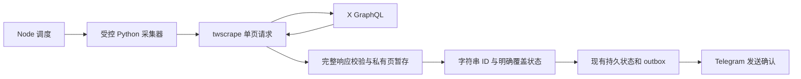

# twscrape 详细研究：是否适合替代 tweet-watcher 的 Bird

研究日期：**2026-10-23，北京时间**。对象：[vladkens/twscrape](https://github.com/vladkens/twscrape)。本项目基线：`bee737a4f3f4b284d983762c637577622ce520f5`。

**结论：值得作为下一代采集器的候选，建议做隔离适配原型；目前不建议直接替换生产 Bird。** 它有公开维护、近期 X 接口适配、Cookie 会话和可选 curl 传输；但默认解析和分页会在某些情况下正常返回却遗漏记录，默认凭据作用域、日志和遥测也需要调整。对本项目而言，价值主要在于持续维护的 X 请求兼容层；完整页校验、覆盖判断、持久去重和消息交付仍需要自己控制。

本次完成了源码审查、正式版与 main 的行为对照、上游离线测试、安全探针及现有解析器兼容检查。**没有使用生产 X 凭据、连接 X 采集、发送 Telegram，或切换生产程序。** 只读获取了公开 GitHub/PyPI 信息和依赖漏洞查询结果；curl 探针只连接隔离命名空间内的本地测试服务器。所有发现对应固定源码快照，不承诺覆盖全部缺陷。

## 1. 它是什么，能解决什么

twscrape 是 Python 异步库和命令行工具，调用 X 网页使用的内部 GraphQL 接口。它需要有效、具备目标内容访问权限的 X 登录会话，通常通过浏览器 Cookie 导入；不需要为这种调用申请官方开发者 API Key。它不是官方 API，也不提供官方 API 的稳定性或服务承诺。

| 能力 | 实际用途和边界 |
|---|---|
| 用户资料、账号时间线 | 可获取账号身份和推文；持续监控最相关。账号不存在、受限、登录失效、请求失败和真正没有新推文必须分别处理 |
| 推文与回复时间线 | `user_tweets` 与 `user_tweets_and_replies` 是不同操作；不能把前者当成账号所有活动 |
| 搜索、列表、社区、关注关系 | 扩展采集来源；搜索并不能证明某账号的完整历史覆盖，限流行为也可能与 UserTweets 不同 |
| 推文详情、回复、线程 | 为已发现记录补内容；引用、转发、回复、长文、文章、编辑信息仍需明确字段映射 |
| 原始响应与模型对象 | 便于调试和结构化处理；公开 `_raw` 分页也会筛选页面，不是每个 HTTP 响应的透明交付 |
| SQLite 会话池、限流轮换 | 管理用于登录请求的账号；不是被监控目标列表，也不是消息队列或持久去重系统 |
| 可选 curl 后端 | 提供浏览器式 TLS 指纹；可能改善部分接口的 HTTPX 拦截问题，不能保证消除挑战或会话失效 |

软件采用 **MIT** 许可，需要 **Python ≥ 3.10、SQLite ≥ 3.24**。采集本身无需支付官方 API 调用费用，服务器、会话维护和接口变化的运维成本仍存在；不能将其理解为无限免费接口。库本身不解决调度、管理面板、Telegram 投递、断电恢复、业务去重或编辑通知。

对于当前项目，适合继续使用 Cookie 模式。无需为评估引入 X 密码、邮箱密码或 TOTP 种子。导入成功仅表示字段齐全，不代表会话有效；本地账号标签也不代表已验证 Cookie 所属的 X 身份。多个被监控账号可以共用一个有权读取它们的登录会话，目标数量不等于登录账号池容量。

## 2. 维护状态：正式版与主分支不同

| 核验项 | 结果 |
|---|---|
| 最新 GitHub Release / PyPI 版本 | **0.20.1**，北京时间 **2026-08-26 00:21** 发布 |
| 正式版提交 | `5271cbdc5da1095b765a2a7ec750b4ac686d581f` |
| 本次审查 main | `63f61a518e576ea5c132f1156c03dda0520d76c1`，提交时间 **2026-10-22 05:19** |
| 正式版之后的维护 | main 有 20 个后续提交，涉及接口、解析、错误语义及发布流程 |
| 下一版状态 | changelog 写有 `v0.21.0`，但尚未核验到对应正式发布；包版本字段仍为 0.20.1 |
| 上游 CI | 该 main SHA 的公开 Actions 显示 Success；Python 3.15 作业配置允许失败 |

因此，**目前仍有实际公开维护，但不能把 main 的修复说成 `pip install twscrape` 已经包含。** main 改进了缺失作者资料、引用混入时间线、GraphQL feature 补齐、部分请求错误误当空结果等问题；同时引入了按 ID 去重、严格 limit 和连续重复页停止等新行为，未必适合本项目的完整性要求。

特别注意：在本次审查快照中，安装 `twscrape[curl]` **不会自动选择 curl**，仍需显式设置 `TWS_HTTP_BACKEND=curl`。拟改变默认行为的 [PR #363](https://github.com/vladkens/twscrape/pull/363) 尚未合并。[PR #364](https://github.com/vladkens/twscrape/pull/364) 的限流/暂停用户/解析错误修复，以及 [PR #361](https://github.com/vladkens/twscrape/pull/361) 的关系 ID 补齐，同样不能算成当前能力。

开放问题与我们的场景直接相关：[issue #348](https://github.com/vladkens/twscrape/issues/348) 指出解析器跳过坏记录却不给调用方缺失信号；[#351](https://github.com/vladkens/twscrape/issues/351) 报告搜索接口的限流轮换问题，但报告者说 UserTweets 正常，不能泛化成全部接口故障。[#337](https://github.com/vladkens/twscrape/issues/337) 针对 HTTPX 的 user_by_id 拦截，也不代表所有时间线请求都失败。

## 3. 最重要的发现：正常结束不等于完整采集

对正式版和 main 各运行了 **28 个合成场景、28 项行为断言**。以下是对持续监控影响最大的复现，不是对线上漏推频率的估计。

| 场景 | 观察结果 | 对监控的影响 |
|---|---|---|
| 一页三条推文，中间一条时间戳坏 | 返回前后两条，调用方没有收到异常；两个版本均存在 | 若据返回值推进水位，中间记录可能以后也不补抓 |
| 被引用推文结构坏 | 可能连外层正常推文一起跳过；两个版本均存在 | 引用内容的问题能扩大为目标账号漏推 |
| 原始页只有置顶指令和游标 | 直接解析能读到推文，但 `user_tweets_raw()` 不交付该页；两个版本均存在 | 切换到 `_raw` 并不能自动解决丢页 |
| 第二页有新推文，但 Bottom 游标重复 | 请求已取得第二页，却在交给调用方前结束；两个版本均存在 | 游标异常被当作结束，新内容不可见 |
| 三个只有游标的空页之后才有内容 | 库在前三页后正常结束；两个版本均存在 | 没有“不完整/尚未覆盖”信号 |
| main 已取得两条完整页，设置 `limit=1` | 高层接口只交付一条 | 条数上限不能用于整页完整性判定 |
| main 连续三页没有新的解析 ID | 正常停止，即使后面还有新条目 | 去重策略被误用为历史覆盖证据 |
| main 同 ID 在后页出现修改后的正文 | 只交付第一次看到的内容 | 需要独立内容版本与编辑关系处理 |

此外，公开 raw 分页只取递归找到的第一个 `entries`，特定模块过滤也可隐藏内容；游标集合仅记上一页，不能识别 A→B→A 循环。模型会丢失条目来自置顶、模块等上下文，缺少文字与合法媒体推文也需要区别判断。详细场景、源码位置和版本差异见[分页审查](pagination-review.md)。

这些行为对“尽量返回能解析的结果”的通用抓取有其用途，但不满足本项目的覆盖契约。**不能用迭代器结束、拿到 N 条或 CLI 退出码 0，证明上次水位到本次之间没有缺口。** 单次请求有 `data` 也可能同时包含 GraphQL `errors`，仍需自行验证。

关系和内容也有边界：

- main 增强了缺失作者时的占位对象和引用识别；占位资料中的空用户名、1970 年时间和 0 统计不是已知真实资料，不能覆盖数据库中已有信息。
- 引用/转发/回复有模型支持，但源对象不可用时，关系身份可能不完整；PR 中拟增加的字段尚不能依赖。需要保存原始关系 ID 和可用性状态。
- note 长文、Article 和编辑链有支持，不代表普通时间线已取得整篇文章，也不等于自动检测、发送编辑/删除通知。
- Python 的整数 ID 精度没有问题，但模型 `.json()` 会输出 JSON number。传给 Node 前必须将推文、作者、会话、引用、回复和编辑链 ID 转为**十进制字符串**；先被 `JSON.parse` 舍入再转字符串无法修复。

## 4. 安全、隐私和运行可靠性

本节源码和认证探针对应上述 **main SHA**，不能不经核验直接套用到正式版。完整源码位置与证据见[认证安全审查](auth-security-review.md)。

### 凭据发送范围需要收紧

主客户端以普通字典设置 Cookie，未绑定域名，也未设置 Secure，并允许自动重定向。后端表现有差异：

| 实测行为 | HTTPX 0.28.1 | curl-cffi 0.16.3 |
|---|---|---|
| 跨 host 302 后携带 auth_token | **是**，模拟 HTTPS 请求 | **否**，本地真实 HTTP/HTTPS 传输 |
| 跨 host 302 后携带 x-csrf-token | **是** | **是** |
| 直接用客户端请求任意其他 host | 本次未单独做该探针 | 首次/复用客户端均带 Cookie 与 CSRF |

这说明存在**条件性凭据暴露风险**，并不是已经发现 X 返回这种跳转或生产账号泄漏。curl 测试使用两个不同 loopback 地址；HTTPS 保持证书验证，只有测试客户端信任临时证书，未修改系统 CA。

接入前应显式限定 Cookie 的 X 域、Secure 属性和敏感请求头作用域，只允许预定 HTTPS 目标，拒绝站外跳转。签名初始化涉及 X 页面与静态资源，也应独立限制目标域、响应大小和总时长。仅换成 curl 不足以替代这些限制。

### 凭据、诊断和遥测默认行为

| 项目 | 发现 | 适合本项目的控制 |
|---|---|---|
| 会话数据库 | SQLite 明文保存 Cookie；若提供密码、邮箱密码、TOTP 种子也会保存。umask 022 下新 DB 为 0644 | 仅 Cookie 模式，独立服务用户、私有 0700 目录、0077 umask、0600 DB 与备份 |
| debug 输出 | 完整响应头含 Set-Cookie，正文也落盘；默认路径位于共享 `/tmp` | 禁用，诊断另走脱敏、限量的私有目录 |
| 解析失败 dump | 即便 debug=False，也可能写出失败对象和整页规范化数据 | 使用自己的严格解析路径；不得仅依赖关闭 debug |
| 密码/邮箱登录日志 | 异常可能带原始密码导入行；INFO 会打印含确认码的邮件主题 | 不引入该登录路线；若以后使用必须先改日志策略 |
| 遥测 | 默认收集操作类型、后端、版本、平台、会话及机器派生标识；CLI finally 会向 PostHog flush | 显式关闭 `TWS_TELEMETRY=0` / `DO_NOT_TRACK=1` 并验证 |

本次在内置遥测调用中**没有发现上传 Cookie、账号名、查询内容或正文的字段**；不能把遥测描述成偷取凭据。纯 API 库调用观察到的是内存收集，没有发现自动 flush；这与 CLI 的实际出站行为应区分。

### 账号池不是完整的任务可靠性层

没有 active 账号时，默认可能返回空结果；账号全部被锁定时，默认可一直等待。需要明确的无账号异常、等待期限、单请求期限和整轮期限。账号失效、目标不可用、限流、解析错误必须在面板中区别于“没有新推文”。

每个账号/operation 的初始锁为 15 分钟，没有 owner token 与持续续租；硬杀会留下锁，超长任务可能和后来任务交叠。因此建议由一个受控采集进程统一管理登录池，以短任务和总预算控制并发，不把它当分布式租约。运行时能修复部分 feature/交易 ID 问题，不会自动升级源码里的所有 GraphQL operation ID。

### 依赖与安装

对研究环境已安装的 **29 个包**向 OSV 执行版本查询，未返回匹配公告。这只是该版本清单和漏洞库的查询结果，未完整审计 curl wheel 中的原生 libcurl/OpenSSL 等组件，也不等于不存在未知问题。

项目依赖声明多为版本下限，`pip install twscrape==0.20.1` 仍会重新解析依赖。将来部署需要固定源码 SHA 或正式 wheel、完整依赖树及哈希，并记录 Python、平台和后端。主分支当前也自报 0.20.1，单看版本号不能区分正式发布与开发源码。具体分发哈希见[维护审查](maintenance-review.md)。

## 5. 已验证到哪一步

| 验证 | 结果 | 不能由此推断 |
|---|---|---|
| main 上游 pytest，全程禁外网、nobody 用户 | **276 通过，82% 行覆盖率** | 真实登录成功率、当前 X 可用性、长期稳定性 |
| 正式版/main 合成分页与模型对照 | 每版 28 场景和 28 断言，共 **56 项行为确认** | 不是 56 个缺陷或 56 项修复，也没有估算线上发生率 |
| HTTPX 安全探针 | 确认跨域模拟转发、DB 权限、debug 内容、敏感日志、遥测字段 | 真实 X 存在可利用跳转或实际凭据已泄漏 |
| curl 真传输探针 | 隔离本地 HTTP/HTTPS；Cookie 与 CSRF 表现已分别记录，TLS 负控通过 | 所有 curl 版本、代理、跨协议跳转、真实 X 行为 |
| 当前 Node 严格解析器对上游 4 个样本 | 普通推文 21 条、含回复 26 条样本通过；缺作者、缺边界两份样本被拒绝 | 无需修改就能完整适配 twscrape |
| 研究环境依赖漏洞库查询 | 29 个包未返回匹配公告 | 所有传递/原生组件安全、未知漏洞不存在 |

上游模型/HTTP/队列覆盖率分别为 94%/99%/92%，但登录为 24%、IMAP 为 32%、交易 ID 为 43%。测试使用 Python 3.13.5；临时环境的部分依赖与上游 uv.lock 不同，实际清单已保存。因此这里给出的是**记录环境上的离线证据**。真实会话、目标最新页面、补抓覆盖、限流恢复和跨日运行尚未验证。

## 6. 与现有 Bird 路线如何衔接

当前 `lib/bird-timeline.mjs` 已避开 Bird 的宽松分页，自己校验时间线整页、置顶与模块、游标和覆盖边界；Node 侧另有持久发送状态和 outbox。替换时应保留这些契约。现有消息状态存储不等同于完整原始响应归档，如要做到失败后可重放整页，还需新增受限的原始页暂存。

| 维度 | 当前方案 | twscrape 适配后的变化 |
|---|---|---|
| 请求与接口兼容 | 固定 Bird 0.8.0，项目自己的请求/分页约束 | 可利用近期公开维护的 operation/features/交易 ID 和 curl 传输 |
| 页面完整性 | 自己严格校验，异常/缺口不应当作覆盖成功 | 仍需自己控制，不能直接依赖高层或 public raw 分页 |
| 交付可靠性 | 现有持久状态、outbox、发送确认 | 可以继续保留，twscrape 账号池不替代它们 |
| 运维 | Node 应用与现有配置 | 增加 Python、SQLite 会话池、依赖锁定和协议适配 |
| 不稳定因素 | X 网页接口与登录会话变化 | 仍然存在；换库提供维护来源，不能获得官方接口保证 |

建议的原型结构如下，**属于设计，尚未实施**：

具体实现重点：

1. **使用受控的单页请求层**，例如 `QueueClient` 或固定版本的 `_gql_item`，每次响应先完整接收再判定；这些内部接口需锁定提交并测试兼容。还需处理请求层重试、错误分类和资源上限，不能简单改个函数名就上线。
2. **自己决定分页终止与覆盖**：明确自然结束、达到旧水位、页数限制、循环、部分响应、未知结构等状态。先留存完整页证据，再推进游标；失败页不能成为覆盖边界。
3. **修订现有严格解析器的合法不完整资料场景**：只有已验证的用户 ID 映射才能补作者信息；缺失边界或未知结构仍要拒绝推进。保留 Pin、模块、引用、回复、编辑链上下文，不能只拿解包后的 Tweet 列表。
4. **限定 Python→Node 协议**：所有身份 ID 为字符串，响应有版本、请求标识、完整性状态、明确错误与大小上限。凭据不放命令行，不写 stdout/stderr，不进入页面证据。
5. **统一运行控制**：显式选择 curl，收紧 Cookie/host/redirect，关闭遥测和默认 dump，使用私有存储；限制请求、页数、字节数、等待和整轮时长，避免多个子进程争抢同一登录账号。可用常驻 helper 复用签名缓存，是否采用由原型测量决定。
6. **保留现有发送契约**：采集覆盖水位、已持久化的新内容和 Telegram 确认分开管理；切换不能清空已有状态或让两套采集器同时写生产 outbox。

原型的验收顺序应是：离线适配及安全加固 → 任务范围确认后的真实只读对照 → 失效会话/限流/坏页/杀进程恢复测试 → 再决定生产切换。只读对照阶段使用既有目标，记录两端返回 ID、正文与关系差异，不写生产水位/outbox、不发 Telegram；切换前准备回退方案。这里没有给出固定工作天数，因为真正的接口成功率和样本差异需要在线验证后才能估计。

**决策建议：推进隔离原型，保留线上现状。** 如果目标是减少未来对公开维护已停止的 Bird 版本的依赖，twscrape 值得投入；如果期望安装后直接获得可靠的不漏推监控，则当前证据不支持。是否进入生产应取决于上述验收，而不取决于 GitHub 活跃度或测试数量。

## 7. 可复核资料

详细分报告：

- [数据完整性、分页与模型](pagination-review.md)
- [认证、账号池与安全](auth-security-review.md)
- [维护、发布与依赖固定](maintenance-review.md)

本地证据：

- [快照与测试元数据](evidence/metadata.json)、[研究环境依赖](evidence/research-requirements.txt)、[上游测试日志](evidence/upstream-tests.log)
- [main 场景结果](evidence/pagination-main.json)、[0.20.1 场景结果](evidence/pagination-v0.20.1.json)
- [HTTPX/账号安全探针结果](evidence/auth-security.json)、[curl HTTP/HTTPS 结果](evidence/curl-security.json)
- [现有解析器兼容检查](evidence/current-adapter-compatibility.json)、[OSV 查询摘要](evidence/dependency-osv.json)
- [分页探针](probes/pagination.py)、[行为断言](probes/assert-pagination.py)、[认证安全探针](probes/auth-security.py)、[curl 探针](probes/curl-security.py)
- [复现说明](REPRODUCE.md)

主要上游来源：

- [固定源码快照](https://github.com/vladkens/twscrape/tree/63f61a518e576ea5c132f1156c03dda0520d76c1)
- [正式版 v0.20.1](https://github.com/vladkens/twscrape/releases/tag/v0.20.1)、[PyPI](https://pypi.org/project/twscrape/)
- [版本差异](https://github.com/vladkens/twscrape/compare/v0.20.1...63f61a518e576ea5c132f1156c03dda0520d76c1)、[固定更新日志](https://github.com/vladkens/twscrape/blob/63f61a518e576ea5c132f1156c03dda0520d76c1/changelog.md)
- [main CI](https://github.com/vladkens/twscrape/actions/runs/39677817606)

以上版本、issue/PR 状态和漏洞查询为研究日期的快照；将来升级须重新核验。
